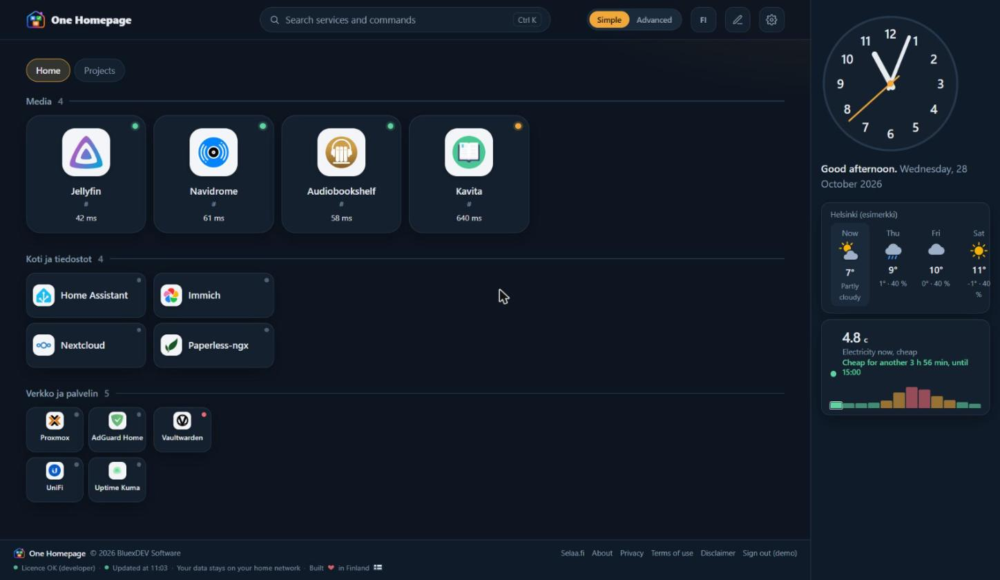
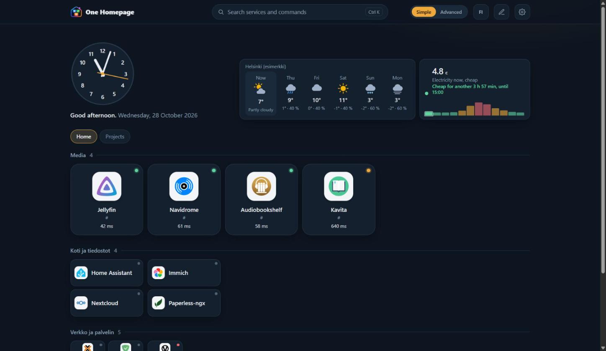
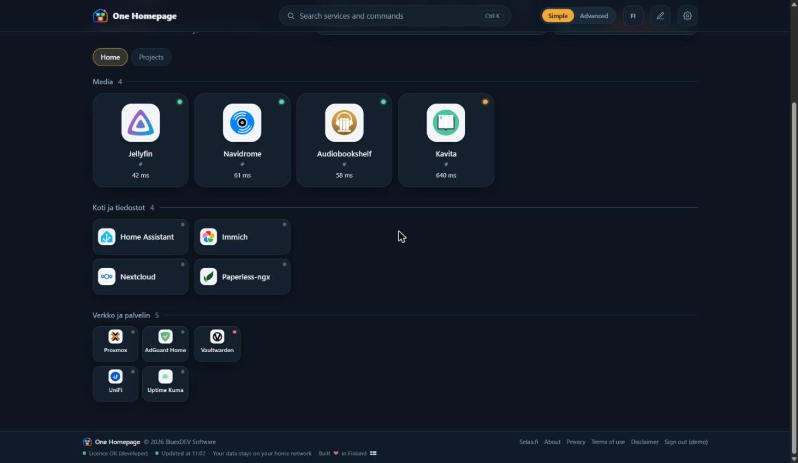
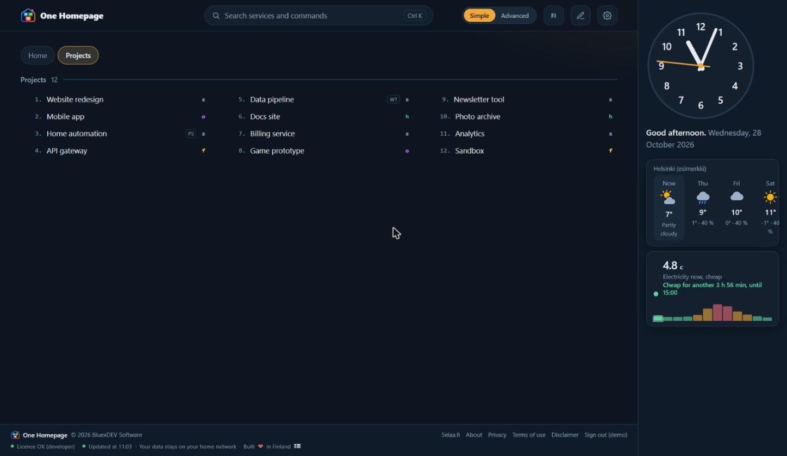
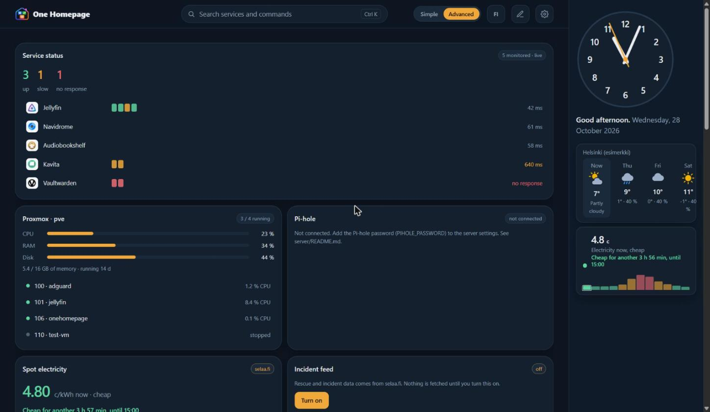
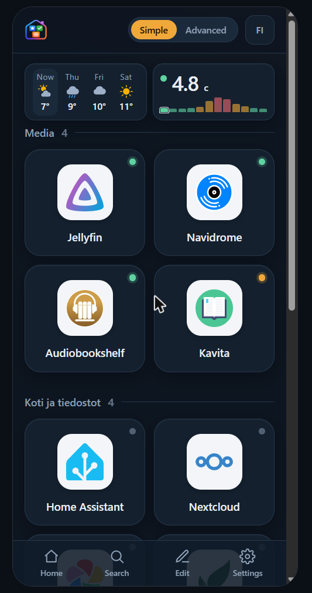

<div align="center">


# One Homepage

**The start page for your home network. One small program, one Proxmox container, about 8 MB of RAM.**<br>
**Kotiverkon aloitussivu. Yksi pieni ohjelma, yksi Proxmox-kontti, noin 8 MB RAM.**

[](../../releases/latest)


[**Install**](#install) · [**Features**](#features) · [**Screenshots**](#screenshots) · [**Licence**](#licence) · [**Suomeksi**](#suomeksi) · [**Terms**](TERMS.md)

<br>



<sub>Sample data. Simple mode with the clock, weather and electricity price in the right sidebar.</sub>

</div>

<br>

## Your whole home lab on one calm page

**Stop hunting for bookmarks, IP addresses and port numbers.** One Homepage turns everything you run at home into a fast,
good-looking start page that knows what is up, what is down and what just appeared on your network.

- 🟢 **See at a glance what works.** Every tile has a live status light and response time, so you know a service is down before anyone else does.
- 🔎 **It finds your stuff for you.** One click scans your network (read-only, no logins) and recognises more than 700 apps and devices. You choose what becomes a tile.
- 💡 **Your smart home on the same page.** Lights, switches, sensors and cameras from Home Assistant, one tap away.
- 🚀 **Launch your day.** A numbered launcher opens a console in the right folder with the right command, one project or ten at once.
- 🎛️ **Calm when you want calm, data when you want data.** **Simple** mode shows only what you need. **Advanced** mode adds live widgets. Same data in both.
- 📱 **Made for your phone too.** Installable as an app, with a bottom bar and safe areas for iPhone.

**Small, fast and yours.** It is one small Go program with the interface built in: no database, no extra containers and no
cloud needed to show the page. About 8 MB of RAM, one command to install, signed updates, and your data stays at home.

<a id="features"></a>

## ✨ Features

| | |
|---|---|
| 🟢 **Tiles with live status** | Every service gets a tile with a logo and a status light, response time and history. Group them, colour them, give groups icons, and drag them around. |
| 🧩 **Three tile sizes** | Normal tiles, **2 per slot** or **4 per slot**: a row of lights or sensors takes the space of a single normal tile. |
| 🗂️ **Up to 10 pages** | Tabs above the content. Put your daily links on the first page and everything else on its own page. |
| 🔎 **Find on your home network** | One click scans your private network (read-only, no logins) and recognises more than 700 apps and devices. You pick what becomes a tile. |
| 💡 **Home Assistant** | Lights, switches, sensors, climate, cameras and media players as live tiles you can tap. Locks and alarms are read-only on purpose. |
| 🚀 **Launcher lists** | A numbered list of projects or commands. Open one, or tick several and open them together, in cmd, PowerShell or Windows Terminal. |
| ⌨️ **Command tiles** | A tile that opens a console in a folder and runs a command on your own PC, after a confirmation. |
| 📊 **Widgets** | Service status, 30 day availability, Proxmox, Pi-hole, Jellyfin, Docker (read-only), tasks, spot electricity price and weather. |
| ⚡ **Search** | Press **Ctrl K**: find a tile, run a command, open row number 7 of a launcher. If nothing matches, Enter searches the web. |
| 📱 **Phone and PWA** | A bottom navigation bar, safe areas for iPhone and an installable app icon. |
| 🎨 **Your layout, your look** | Three themes, three densities, widgets on top or in a left or right sidebar, Finnish and English. |
| 📦 **Import and backup** | Bring over a layout from Homer, Homepage or Dashy. Export and restore a backup. No secrets are included. |
| 🔔 **Alerts** | Optional Telegram messages when a service or device goes down or comes back. |
| 🛡️ **Safe updates** | Updates come from this repository, are checked against an Ed25519 signature and a checksum, and roll back automatically if the new version does not start. |

<a id="screenshots"></a>

## 🖼️ Screenshots

<table>
<tr>
<td width="50%"><br><sub><b>Widgets on top.</b> Clock, weather and electricity above your pages.</sub></td>
<td width="50%"><br><sub><b>Three tile sizes.</b> Normal, 2 per slot and 4 per slot in the same page.</sub></td>
</tr>
<tr>
<td width="50%"><br><sub><b>Launcher list.</b> Numbered rows, Claude model badge, PowerShell or Windows Terminal tags.</sub></td>
<td width="50%"><br><sub><b>Advanced mode.</b> Service status, Proxmox, Pi-hole and more.</sub></td>
</tr>
</table>

<div align="center">
<br>
<sub>On a phone. All screenshots use sample data.</sub>
</div>

<a id="install"></a>

## 📥 Install / Asennus

You need a **Proxmox VE** host. The installer creates a small **Debian 13** container (1 core, 256 MB RAM, 2 GB disk), downloads
the latest signed release into it and starts the service.

> **A free BluexDEV account (auth.selaa.fi) and a licence key are required.** The first 7 days of a new installation work
> without them; after that One Homepage stays locked until you link a licence. The steps below get you both, in this order.

**Start here: [auth.selaa.fi/start/onehomepage](https://auth.selaa.fi/start/onehomepage)**. A public page that walks you through the steps below in this
order: account, licence key, install, link.

### Step by step

1. **Create your free account.** [Create a BluexDEV account](https://auth.selaa.fi/bluex-portal-2026-login/create-account?app=onehomepage): email, username and password. **Confirm your email**
   when the message arrives, then sign in.
2. **Get your install command and licence key.** [Sign in](https://auth.selaa.fi/bluex-portal-2026-login?app=onehomepage) and open **Install** (Asenna) in your account. It shows the install
   command for One Homepage with a copy button, and **your free licence key is created for you the moment you open it**. It
   also shows under **Your licence** on your account page.
3. **Run it in the Proxmox shell** as root. When it is done it prints the address of your new page and how to read the
   setup code:

   ```bash
   pct exec <CTID> -- cat /opt/onehomepage/var/setup_code.txt
   ```

   The first person who signs in with that code becomes the owner. Others are invited as editor or viewer.
4. **Link the installation to your account.** This attaches your licence to the installation. In One Homepage open
   **Settings → Link to account**. It shows a code like `ABCD-EFGH`. Open [auth.selaa.fi/device](https://auth.selaa.fi/device) (Settings shows the link) and enter the code, sign in, check the machine name and press **Approve**. The page in Settings
   updates by itself. If you skipped step 2, the licence key is created here at the latest.

Reserve the container's address in your router so that it does not change. **Updates** are in Settings → Updates: every release
carries `checksums.txt` and a signature, and the program verifies both before it installs anything.

### Installing straight from this repository

If you already have an account, or you want to try it first, the same installer can be run directly in the Proxmox shell:

```bash
bash -c "$(curl -fsSL https://raw.githubusercontent.com/JuhaFIN1/onehomepage-releases/main/install.sh)"
```

> **Remember: the account and the licence key are mandatory.** This command installs One Homepage and it works for 7 days, but
> it does not give you an account or a licence. Do it now so that nothing locks later:
> **[1. create your account](https://auth.selaa.fi/bluex-portal-2026-login/create-account?app=onehomepage)** (and confirm your email), then **[2. sign in](https://auth.selaa.fi/bluex-portal-2026-login?app=onehomepage)**, and in One Homepage use
> **Settings → Link to account** and approve at **[auth.selaa.fi/device](https://auth.selaa.fi/device)**.

If your Proxmox does not offer a Debian 13 template yet, the installer falls back to Debian 12 and tells you so. You can set
`CTID`, `STORAGE`, `BRIDGE`, `CHANNEL=dev` and `DEBIAN` as environment variables to change the defaults. It runs on amd64
and arm64.

<a id="licence"></a>

## 🔑 Account and licence / Tili ja lisenssi

One Homepage needs a free **BluexDEV account** and a **licence key**. There is no password database in the program itself: you
sign in with your BluexDEV account.

| | |
|---|---|
| **Start page** | [auth.selaa.fi/start/onehomepage](https://auth.selaa.fi/start/onehomepage): all the steps in order, with the buttons. |
| **Create an account** | [auth.selaa.fi, create account](https://auth.selaa.fi/bluex-portal-2026-login/create-account?app=onehomepage). Confirm your email. |
| **Sign in** | [auth.selaa.fi, sign in](https://auth.selaa.fi/bluex-portal-2026-login?app=onehomepage) |
| **Get the licence key** | Created for you when you open **Install** in your account (step 2), and at the latest when you link the installation (step 4). It is shown under **Your licence** in your account. |
| **Without a licence** | The first 7 days work without one. After that One Homepage is locked until you link a licence. |

> **Licence keys are free for the time being.** BluexDEV may change the terms, limit the free licence or make the program or
> new versions paid in the future, and free access is not guaranteed. See [TERMS.md](TERMS.md).

## 🪟 Command tiles on Windows

A browser cannot start programs by itself. For command tiles and launcher lists, Settings has a small **Windows helper**
(a PowerShell script, installed once, for your Windows user only). It registers an address that opens a console in the folder
you chose. Before anything runs, a window shows the folder, the shell and the command and asks for confirmation. You can
choose to remember a command; if the command changes, you are asked again. Remove the helper any time by running the script
again with `-Uninstall`.

**How to run it on Windows 11:** open **Terminal** (right-click Start), then:

```powershell
cd $HOME\Downloads
powershell -ExecutionPolicy Bypass -File ./onehomepage-run-setup.ps1
```

(Or right-click the file, **Show more options**, **Run with PowerShell**.) No administrator rights are needed.

## 🔒 Privacy / Yksityisyys

The program and your data stay on your own server. Optional features contact only what you switch on (for example weather from
[Open-Meteo](https://open-meteo.com/), electricity price and incident content from selaa.fi, Telegram alerts, your own Home
Assistant). Network scanning is limited to private addresses and read-only queries. Sign-in and the licence check go to
auth.selaa.fi, and updates come from this repository. Tokens and passwords you enter stay on your server.

## ❓ Questions

**Does it work without internet?** Yes, once installed. Sign-in uses a signed local session that survives an outage of
auth.selaa.fi, and the licence check has a 30 day offline grace period.
**Can I run it outside Proxmox?** The installer is made for Proxmox containers. The release files are plain Linux binaries
(amd64 and arm64), but only the Proxmox install is supported for now.
**Is my data sent to BluexDEV?** No. See Privacy above.
**Something is wrong:** open an [issue](../../issues).

---

## Suomeksi

**Koko kotilabrasi yhdellä rauhallisella sivulla.** One Homepage muuttaa kaiken kotona pyörivän nopeaksi ja kauniiksi
aloitussivuksi, joka tietää mikä toimii, mikä on alhaalla ja mikä juuri ilmestyi verkkoosi. 🟢 Tilavalo ja vasteaika joka tiilessä.
🔎 Haku löytää laitteesi ja palvelusi itse. 💡 Home Assistantin valot ja anturit samalla sivulla. 🚀 Numeroitu käynnistin avaa
konsolin oikeaan kansioon. 🎛️ **Simple**-tila on rauhallinen, **Advanced** lisää live-widgetit, ja data on sama. 📱 Toimii
puhelimessa ja PWA:na. Yksi pieni Go-ohjelma, ei tietokantaa, noin 8 MB RAM, ja tietosi pysyvät kotona.

**Ominaisuudet:** tiilet tilatiedoin, kolme tiilikokoa (normaali, 2 tai 4 per ruutu), enintään 10 sivua välilehtinä, haku
kotiverkosta (yli 700 sovellusta ja laitetta, vain lukevat kyselyt), Home Assistant, käynnistinlistat ja komentotiilet
(cmd, PowerShell tai Windows Terminal), widgetit (tila, saatavuus, Proxmox, Pi-hole, Jellyfin, Docker, tehtävät, pörssisähkö,
sää), Ctrl K -haku (jos ei osumia, Enter hakee verkosta), puhelinnäkymä ja PWA, kolme teemaa, widgetit ylhäällä tai
sivupalkissa, suomi ja englanti, tuonti Homerista, Homepagesta ja Dashystä sekä Telegram-hälytykset.

**Asennus (tarvitset Proxmox VE -palvelimen).** Ilmainen **BluexDEV-tili** (auth.selaa.fi) ja **lisenssiavain** ovat pakollisia.
Uuden asennuksen ensimmäiset 7 päivää toimivat ilman, sen jälkeen One Homepage lukittuu kunnes liität lisenssin. Aloita täältä: **[auth.selaa.fi/start/onehomepage](https://auth.selaa.fi/start/onehomepage)**, jossa vaiheet ovat samassa järjestyksessä. Tee näin:

1. **Luo ilmainen tili:** [luo BluexDEV-tili](https://auth.selaa.fi/bluex-portal-2026-login/create-account?app=onehomepage) (sähköposti, käyttäjänimi, salasana) ja **vahvista sähköpostisi**.
2. **Hae asennuskomento ja lisenssiavain:** [kirjaudu sisään](https://auth.selaa.fi/bluex-portal-2026-login?app=onehomepage) ja avaa tililläsi **Asenna**. Siellä on One Homepagen asennuskomento ja kopioi-nappi, ja **ilmainen lisenssiavaimesi luodaan puolestasi heti kun avaat sivun**. Se näkyy myös tilisi kohdassa **Lisenssisi**.
3. **Aja komento Proxmoxin shellissä** rootina. Asennin luo pienen **Debian 13** -kontin, lataa siihen viimeisimmän allekirjoitetun
   julkaisun ja kertoo osoitteen. Asetuskoodi: `pct exec <CTID> -- cat /opt/onehomepage/var/setup_code.txt`. Ensimmäinen koodilla
   kirjautuva on omistaja.
4. **Liitä asennus tiliisi.** Liittäminen kiinnittää lisenssin tähän asennukseen. Avaa One Homepagessa **Asetukset → Liitä tiliin**. Näytetään koodi
   (esim. `ABCD-EFGH`). Avaa [auth.selaa.fi/device](https://auth.selaa.fi/device), kirjaudu, tarkista koneen nimi ja paina **Hyväksy**. Jos
   ohitit vaiheen 2, lisenssiavain luodaan viimeistään tässä.

Jos asennat suoraan tämän repon komennolla (`bash -c "$(curl -fsSL https://raw.githubusercontent.com/JuhaFIN1/onehomepage-releases/main/install.sh)"`), muista, että **tili ja lisenssiavain ovat pakollisia**:
tee vaiheet 1, 2 ja 4 heti, ettei sivu lukitu 7 päivän jälkeen. Päivitykset: Asetukset → Päivitykset (allekirjoitus ja tarkistussumma
tarkistetaan ennen asennusta).

**Lisenssiavaimet ovat toistaiseksi ilmaisia**, mutta BluexDEV voi jatkossa muuttaa ehtoja, rajoittaa ilmaista lisenssiä tai tehdä
ohjelmasta maksullisen, eikä ilmaisuutta taata ([TERMS.md](TERMS.md)).

**Komentotiilet Windowsissa:** Asetuksista ladattava pieni apuri (PowerShell, asennus kerran, vain omalle käyttäjällesi) avaa
konsolin valittuun kansioon. Ennen ajoa Windows näyttää kansion, kuoren ja komennon ja kysyy vahvistuksen.

**Yksityisyys:** ohjelma ja tietosi pysyvät omalla palvelimellasi. Valinnaiset ominaisuudet ottavat yhteyttä vain siihen, minkä
kytket päälle. Verkkohaku rajoittuu yksityisiin osoitteisiin ja vain lukeviin kyselyihin.

## Terms / Käyttöehdot

Owner: **BluexDEV Software**. You may not modify, copy or redistribute the program, use its code elsewhere, or present it as your
own. Full terms (English and Finnish): [TERMS.md](TERMS.md). Third-party components and data sources: [NOTICE.md](NOTICE.md).

Omistaja: **BluexDEV Software**. Et saa muokata, kopioida tai levittää ohjelmaa, käyttää sen koodia muualla tai esittää sitä
omanasi. Täydet ehdot (englanti ja suomi): [TERMS.md](TERMS.md). Kolmannen osapuolen osat ja tietolähteet: [NOTICE.md](NOTICE.md).

<div align="center"><sub>© 2026 BluexDEV Software. All rights reserved. Kaikki oikeudet pidätetään.<br>
Product names and logos shown in screenshots belong to their owners and identify those services only.</sub></div>
